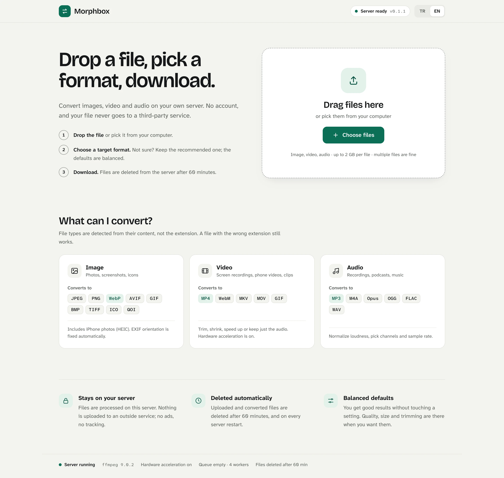
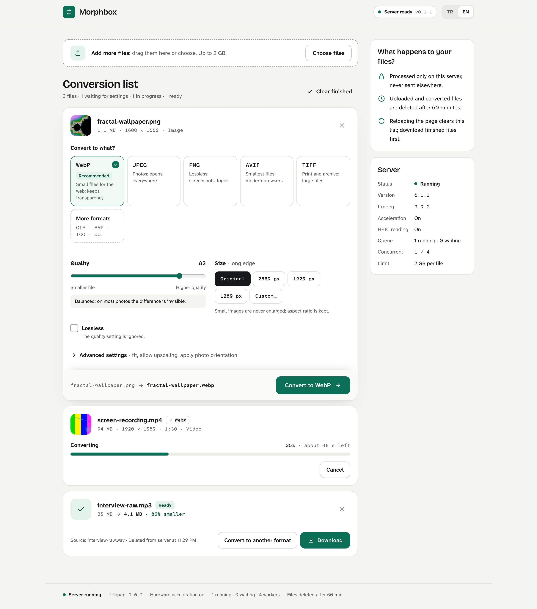
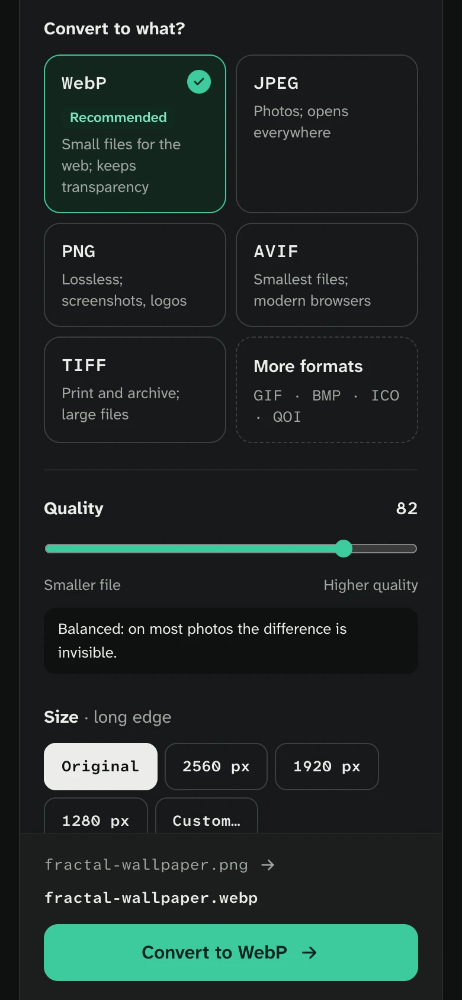

# Dönüştür

[Türkçe](README.md)

A self-hosted image, video and audio converter. Drop a file in the browser, pick a target
format, watch the progress live, download. No accounts, no database, no outside services:
files are processed only on your own server and deleted after 60 minutes.

*Dönüştür* is Turkish for "convert". The interface ships in Turkish and English.



<p>
  
  
</p>

<sub>Start screen · conversion list (image being set up, video at 35%, audio ready) · mobile dark theme</sub>

- **Backend:** Rust (axum 0.8 + tokio). Images in pure Rust (`image`, `webp`, `ravif`); video and
  audio through the system `ffmpeg` as a subprocess (`-progress pipe:1` for real percentages).
- **Frontend:** Vite + React 19 + TypeScript + Tailwind v4, **embedded in the single binary** with
  `rust-embed`. Fonts are bundled too, so no request goes to Google Fonts.
- **Delivery:** a prebuilt Docker image (amd64 + arm64), `docker compose`, or one binary.

## Install

Every install is its own copy: people run Dönüştür on their own machine, not on yours. Each
option ends at http://localhost:8080.

### 1. Prebuilt image (easiest)

Needs only [Docker](https://docs.docker.com/get-docker/); works on Windows, Linux and macOS.

```bash
docker run -d --name donustur -p 8080:8080 -v donustur-data:/data --restart unless-stopped ghcr.io/mehmetvarol/donustur:latest
```

Add `-e DONUSTUR_PASSWORD=...` to require a password. GitHub Actions publishes the image on every
push to `main` (`.github/workflows/image.yml`); version tags look like `v0.2.0`.

### 2. From source, with Docker

```bash
git clone https://github.com/mehmetvarol/donustur.git && cd donustur
docker compose up -d --build
```

The first build takes a few minutes because of Rust. The image is `debian:trixie-slim` + ffmpeg +
libheif, runs as a non-root user, has a `HEALTHCHECK` on `/api/health`, and **reads HEIC**.

### 3. Without Docker (macOS / Linux)

You need [Rust](https://rustup.rs), Node 22 and ffmpeg; libheif ≥ 1.17 for HEIC.

```bash
brew install ffmpeg libheif pkgconf     # Debian/Ubuntu: apt install ffmpeg libheif-dev clang pkg-config
make build-heic                          # without HEIC: make build
./target/release/donustur
```

Set `DONUSTUR_HWACCEL=auto` for macOS VideoToolbox; it falls back to libx264 if that fails. Linux
inside Docker cannot use VideoToolbox, so on a Mac this is the fastest option.

**Start at login on macOS:** `make launchd` writes a LaunchAgent for this machine and prints the
commands to install it (template: `deploy/com.donustur.server.plist`).

### Exposing it to the internet

Dönüştür is built for home and small-office use. On a public address:

1. Set `DONUSTUR_PASSWORD`, otherwise anyone can use your CPU.
2. Put a TLS reverse proxy in front and raise its body limit. Caddy example:

```
donustur.example.com {
	request_body {
		max_size 2GB
	}
	reverse_proxy localhost:8080
}
```

## Configuration

| Variable | Default | Meaning |
|---|---|---|
| `DONUSTUR_HOST` | `0.0.0.0` | Listen address |
| `DONUSTUR_PORT` | `8080` | Port |
| `DONUSTUR_DATA_DIR` | `./data` | Holds `uploads/` and `outputs/`; wiped at startup |
| `DONUSTUR_WORKERS` | CPUs/2 (≥1) | Concurrent conversions |
| `DONUSTUR_TTL_MIN` | `60` | Minutes before jobs and files are deleted |
| `DONUSTUR_MAX_UPLOAD_MB` | `2048` | Upload limit |
| `DONUSTUR_JOB_TIMEOUT_MIN` | `30` | Timeout for a single job |
| `DONUSTUR_PASSWORD` | empty | When set, `/api/*` needs it (Bearer or `?token=`); the UI shows a sign-in screen |
| `DONUSTUR_HWACCEL` | off | `auto` uses `h264_videotoolbox` when available |
| `DONUSTUR_FFMPEG` / `DONUSTUR_FFPROBE` | `ffmpeg` / `ffprobe` | Binary paths |
| `RUST_LOG` | `donustur=info` | Log level |

## Formats

| Input | Targets |
|---|---|
| Image (png, jpeg, gif, bmp, tiff, webp, avif\*, ico, tga, qoi, heic\*\*) | JPEG, PNG, WebP (lossy/lossless), AVIF, GIF, BMP, TIFF, ICO, QOI |
| Video (mp4, mov, mkv, webm, avi…) | MP4 (H.264+AAC), WebM (VP9+Opus), MKV, MOV, animated GIF, plus every audio target |
| Audio (mp3, m4a, wav, flac, ogg, opus…) | MP3, AAC/M4A, Opus, OGG (Vorbis), FLAC, WAV |

File types are detected from content (magic bytes), not the extension; a mismatch returns **415**.
The catalog lives in one place, `src/formats.rs`, and the UI reads it from `/api/formats`.

\* AVIF is write-only. \*\* HEIC needs `--features heic` and libheif ≥ 1.17; it is on in the Docker image.

## API

| Endpoint | Purpose |
|---|---|
| `GET /api/health` | version, ffmpeg version, heic, queue, workers, limits |
| `GET /api/formats` | target catalog: `id, label, kind, ext, mime, accepts[], options[], available` |
| `POST /api/jobs` | multipart: `file`, `target`, `options` (JSON) → 202 `{id, status}` |
| `GET /api/jobs/{id}` | `queued/running/done/failed/cancelled`, `progress`, `input`, `output`, `error` |
| `GET /api/jobs/{id}/events` | SSE: a `job` event on every change; closes when finished |
| `GET /api/jobs/{id}/download` | the file (Range support, `Content-Disposition: attachment`) |
| `DELETE /api/jobs/{id}` | cancel and delete files |

## Security

- Job ids are UUID v4; file names are generated on the server, user input never reaches a path.
- ffmpeg arguments are passed as a list with no shell; every option goes through a whitelist and range check.
- Timeouts and the TTL leave no stray files; `data/` is wiped on restart.
- CSP, `nosniff`, `frame-ancestors 'none'`; no CORS (same origin only).

## Development

```bash
make test     # cargo test + frontend type check
cargo test --features heic
make lint     # clippy -D warnings + fmt --check
make dev      # binary on 8080; in another terminal: cd web && npm run dev (Vite on 5173)
```

## License

[MIT](LICENSE). Bundled fonts are under the SIL Open Font License 1.1 (`@fontsource-variable/*`).
