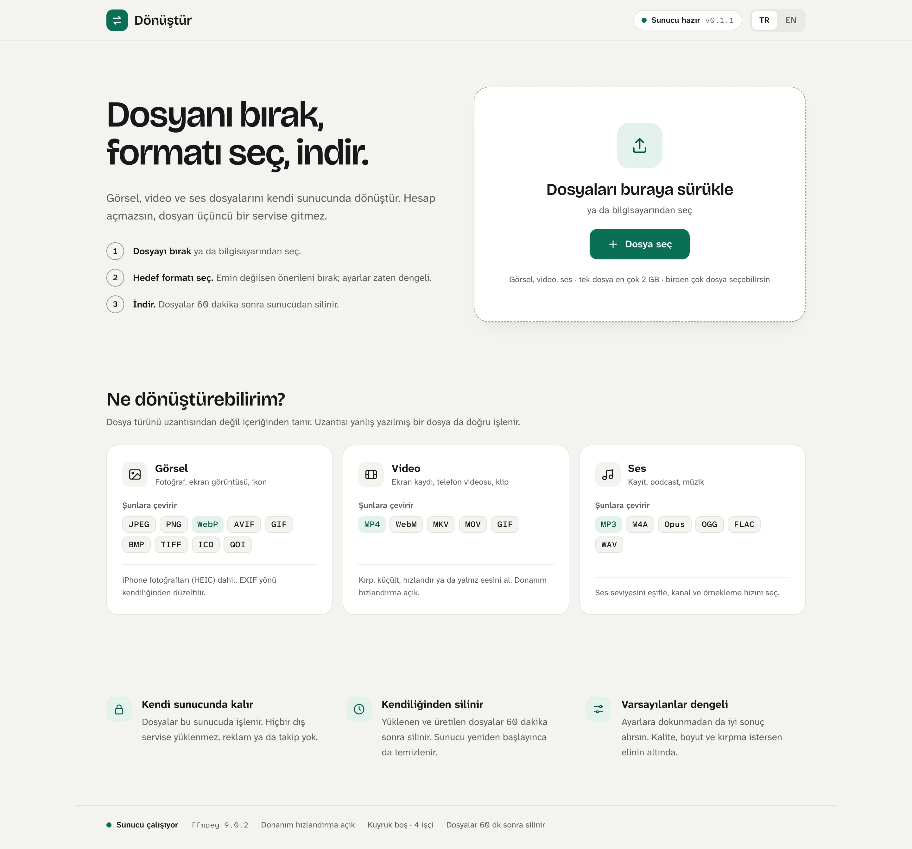
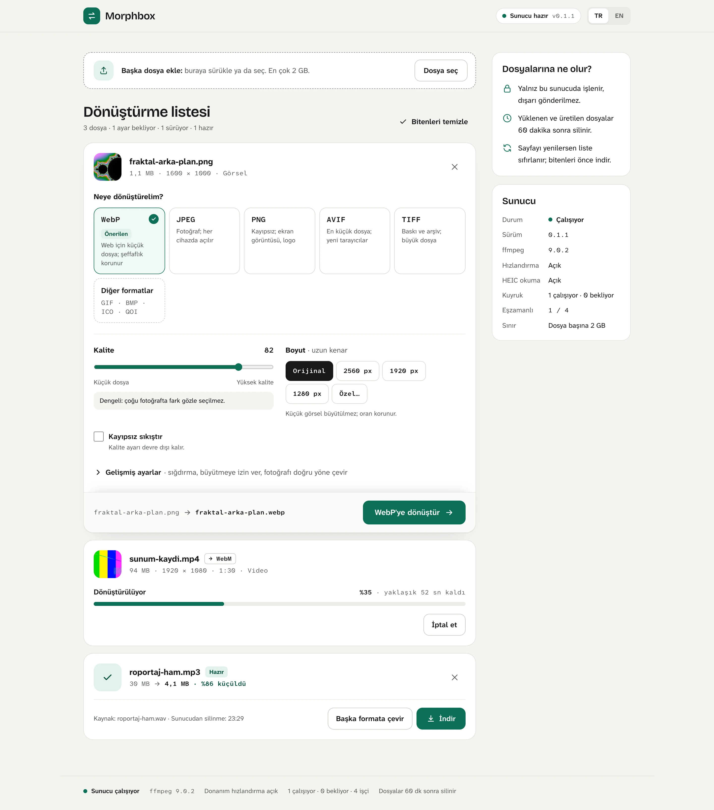
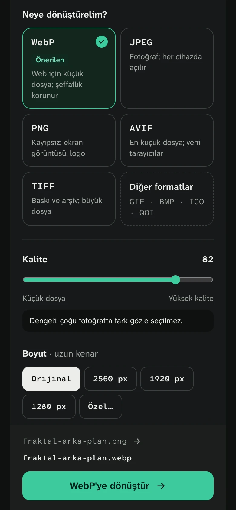

# Morphbox

[English](README.en.md)

Kendi sunucunda çalışan görsel / video / ses dönüştürücü. Tarayıcıdan dosyayı bırak, hedef
formatı seç, ilerlemeyi canlı izle, indir. Hesap yok, veritabanı yok, dış servis yok: dosyalar
yalnız senin sunucunda işlenir ve 60 dakika sonra silinir.



<p>
  
  
</p>

<sub>Başlangıç ekranı · dönüştürme listesi (görsel ayarda, video %35, ses hazır) · mobil koyu tema</sub>

- **Arka uç:** Rust (axum 0.8 + tokio). Görseller saf Rust (`image`, `webp`, `ravif`); video/ses
  sistemdeki `ffmpeg` alt süreç olarak (`-progress pipe:1` ile gerçek yüzde).
- **Ön yüz:** Vite + React 19 + TypeScript + Tailwind v4; `rust-embed` ile **tek ikiliye gömülü**.
  Yazı tipleri (Bricolage Grotesque, Atkinson Hyperlegible Next/Mono) pakete gömülü; Google Fonts'a
  istek gitmez, CSP `default-src 'self'` bozulmaz.
- **Dağıtım:** hazır Docker imajı (amd64 + arm64), `docker compose` ya da tek ikili.

## Kurulum

Her kurulum kendi kopyasıdır: başkası senin sunucunu değil, kendi bilgisayarındaki Morphbox'ı
kullanır. Hepsi sonunda http://localhost:8080 adresini açar.

### 1. Hazır imaj (en kolay)

Yalnız [Docker](https://docs.docker.com/get-docker/) gerekir; Windows, Linux ve macOS'ta çalışır.

```bash
docker run -d --name morphbox -p 8080:8080 -v morphbox-data:/data --restart unless-stopped ghcr.io/mehmetvarol/morphbox:latest
```

Şifre istersen `-e MORPHBOX_PASSWORD=...` ekle. İmajı `main`'e her gönderimde GitHub Actions
yayınlar (`.github/workflows/image.yml`); sürüm etiketleri `v0.2.0` gibi `v*` ile gelir.

### 2. Kaynaktan, Docker ile

```bash
git clone https://github.com/mehmetvarol/morphbox.git && cd morphbox
docker compose up -d --build
```

İlk derleme Rust yüzünden birkaç dakika sürer. İmaj: `debian:trixie-slim` + ffmpeg + libheif, root
olmayan kullanıcı, `HEALTHCHECK` `/api/health`, **HEIC desteği açık**. Taban trixie'dir çünkü
bookworm'daki libheif 1.15, `libheif-rs`'in istediği ≥1.17'nin altında.

macOS'ta Docker Desktop yerine [colima](https://github.com/abiosoft/colima) yeter:

```bash
brew install colima docker docker-compose
mkdir -p ~/.docker/cli-plugins && ln -sfn /opt/homebrew/opt/docker-compose/bin/docker-compose ~/.docker/cli-plugins/
colima start --cpu 4 --memory 6 --vm-type vz
```

### 3. Docker'sız (macOS / Linux)

Gerekenler: [Rust](https://rustup.rs), Node 22, ffmpeg; HEIC için libheif ≥1.17.

```bash
brew install ffmpeg libheif pkgconf     # Debian/Ubuntu: apt install ffmpeg libheif-dev clang pkg-config
make build-heic                          # HEIC'siz: make build
./target/release/morphbox
```

Varsayılan olarak yalnız bu bilgisayardan açılır. Telefon gibi aynı ağdaki cihazlardan da kullanmak
istersen `MORPHBOX_HOST=0.0.0.0` ile başlat; o zaman `MORPHBOX_PASSWORD` vermeyi de düşün.

Donanım hızlandırma (macOS VideoToolbox) için `MORPHBOX_HWACCEL=auto`; başarısız olursa kendiliğinden
libx264'e düşer. Docker içindeki Linux VideoToolbox'ı kullanamaz; Mac'te en hızlısı bu yoldur.

**macOS'ta açılışta başlatma:** `make launchd` bu makineye göre bir LaunchAgent dosyası üretir ve
kurulum komutlarını yazar (şablon: `deploy/com.morphbox.server.plist`).

Geliştirme: `make dev` (ikili, 8080) + ayrı pencerede `cd web && npm run dev` (Vite, 5173,
`/api`'yi 8080'e proxy'ler).

### İnternete açarken

Morphbox ev/ofis ölçeği için tasarlandı. Herkese açık bir adreste çalıştıracaksan:

1. `MORPHBOX_PASSWORD` ver; yoksa herkes senin işlemcinle dönüştürür.
2. Önüne TLS'li bir ters vekil koy ve gövde sınırını yükselt. Caddy örneği:

```
morphbox.example.com {
	request_body {
		max_size 2GB
	}
	reverse_proxy localhost:8080
}
```

## Ortam değişkenleri

| Değişken | Varsayılan | Açıklama |
|---|---|---|
| `MORPHBOX_HOST` | `127.0.0.1` | Dinlenen adres. Varsayılan yalnız bu bilgisayar; aynı ağdaki cihazlar için `0.0.0.0` (Docker imajında böyle) |
| `MORPHBOX_PORT` | `8080` | Port |
| `MORPHBOX_DATA_DIR` | `./data` | `uploads/` ve `outputs/` burada; açılışta temizlenir |
| `MORPHBOX_WORKERS` | CPU/2 (≥1) | Eşzamanlı dönüşüm sayısı |
| `MORPHBOX_TTL_MIN` | `60` | İş ve dosyaları kaç dakika sonra sil |
| `MORPHBOX_MAX_UPLOAD_MB` | `2048` | Yükleme sınırı |
| `MORPHBOX_JOB_TIMEOUT_MIN` | `30` | Tek iş için zaman aşımı |
| `MORPHBOX_PASSWORD` | boş | Tanımlıysa `/api/*` için şifre (Bearer ya da `?token=`); ön yüz şifre ekranı gösterir |
| `MORPHBOX_HWACCEL` | kapalı | `auto` → varsa `h264_videotoolbox` |
| `MORPHBOX_FFMPEG` / `MORPHBOX_FFPROBE` | `ffmpeg` / `ffprobe` | İkili yolları |
| `RUST_LOG` | `morphbox=info` | Günlük seviyesi |

## API

| Uç | Açıklama |
|---|---|
| `GET /api/health` | sürüm, ffmpeg sürümü, heic, kuyruk, işçi, sınırlar |
| `GET /api/formats` | hedef kataloğu: `id, label, kind, ext, mime, accepts[], options[], available` |
| `POST /api/jobs` | multipart: `file`, `target`, `options` (JSON). 202 → `{id, status}` |
| `GET /api/jobs/{id}` | durum: `queued/running/done/failed/cancelled`, `progress`, `input`, `output`, `error` |
| `GET /api/jobs/{id}/events` | SSE: her değişimde `job` olayı; bitince kapanır |
| `GET /api/jobs/{id}/download` | dosya (Range destekli, `Content-Disposition: attachment`) |
| `DELETE /api/jobs/{id}` | iptal + dosyaları sil |

Hatalar: `{ "error": { "code", "message" } }`. Dosya türü uzantıyla değil sihirli baytla
belirlenir; uyuşmayan tür **415**.

## Format matrisi

| Giriş | Hedefler |
|---|---|
| Görsel (png, jpeg, gif, bmp, tiff, webp, avif*, ico, tga, qoi, heic**) | JPEG, PNG, WebP (kayıplı/kayıpsız), AVIF, GIF, BMP, TIFF, ICO, QOI |
| Video (mp4, mov, mkv, webm, avi…) | MP4 (H.264+AAC), WebM (VP9+Opus), MKV, MOV, GIF (hareketli) + tüm ses hedefleri |
| Ses (mp3, m4a, wav, flac, ogg, opus…) | MP3, AAC/M4A, Opus, OGG (Vorbis), FLAC, WAV |

Görsel seçenekleri: kalite, boyutlandırma (contain/cover/fill, büyütme kapalı), EXIF yönü,
arka plan rengi (saydamlık düzleştirme). Video: CRF, preset, çözünürlük (yalnız küçültür),
fps, kesme, hız (0,25–4×), sessiz. Ses: bit hızı, örnekleme, kanal, loudnorm, kesme.
Katalog **tek yerde** tanımlı: `src/formats.rs`; ön yüz `/api/formats`'tan okur.

\* AVIF yalnız **yazılır** (ravif); okumak için dav1d gerekir, dahil değil.
\*\* HEIC/HEIF okuma `--features heic` + sistem `libheif` ≥1.17 ister (`brew install libheif pkgconf`,
Debian/Ubuntu `libheif-dev clang pkg-config`). Docker imajında açık; macOS'ta `make build-heic`.

## Güvenlik

- İş kimliği UUID v4; dosya adları sunucuda üretilir, kullanıcı girdisi yola girmez.
- ffmpeg argümanları liste olarak verilir, kabuk yok; tüm seçenekler beyaz liste + sayısal aralıktan geçer.
- Zaman aşımı ve TTL ile artık dosya kalmaz; yeniden başlatmada `data/` temizlenir.
- CSP, `nosniff`, `frame-ancestors 'none'`; CORS kapalı (aynı kaynak).
- İsteğe bağlı tek şifre. Çok kullanıcılı internet dağıtımı için önüne ters vekil (Caddy/nginx, TLS) koy.

## Testler

```bash
make test     # cargo test (27 test: katalog + her varsayılanın doğrulamadan geçmesi,
              # ffmpeg argümanları, progress ayrıştırıcı, görsel dönüşüm, API uçtan uca;
              # ffmpeg varsa 1 sn test videosu üretip mp3/gif/mp4/webm) + ön yüz tsc
cargo test --features heic   # +1: HEIC→JPEG (tests/fixtures/sample-640x480.heic)
make lint     # clippy -D warnings + fmt --check
```

## Arayüz

- Tema tokenları `web/src/index.css` içinde (açık/koyu, tüm metinler en az 4,5:1 kontrast).
- Hedef açıklamaları, seçenek etiketleri ve Türkçe ekler (WebP'ye, JPEG'e) `web/src/meta.ts`'te;
  katalog yine sunucudan gelir, bilinmeyen anahtar sunucunun etiketiyle gösterilir.
- Türkçe sayı biçimi: `%90`, `3,1 MB`, `4032 × 3024` (`web/src/i18n.ts`).
- Süresi bilinmeyen medyada (ör. tarayıcı kaydı WebM) ffmpeg yüzde veremez; arayüz belirsiz
  çubuk ve geçen süre gösterir.

## Bilinen sınırlar

- İşler bellekte: sunucu yeniden başlayınca kuyruk ve dosyalar gider (tasarım tercihi).
- Hareketli WebP/GIF **girişi** tek kare olarak işlenir (görsel motoru). Hareketli çıktı için
  video → "GIF (hareketli)".
- OGG hedefi `libvorbis` yoksa deneysel `vorbis` kodlayıcıya düşer (daha düşük kalite).
- Ters vekil arkasında büyük yüklemeler için vekilin gövde sınırını da yükselt.

## Varsayımlar

- Tek kullanıcı / ev-ofis ölçeği; dış kuyruk (Redis) ve veritabanı bilerek yok.
- Homebrew ffmpeg 9'da `libwebp` kodlayıcısı ve HEIF okuyucu yok; bu yüzden görseller
  ffmpeg'e değil saf Rust yoluna bağlandı.

## Yapı

```
src/
  main.rs          router, katmanlar, graceful shutdown
  config.rs        MORPHBOX_* ortam değişkenleri
  formats.rs       hedef kataloğu + seçenek doğrulama (tek doğruluk kaynağı)
  probe.rs         sihirli bayt (infer), ffprobe, görsel boyutu
  jobs.rs          kuyruk (semaphore), watch ile ilerleme, iptal, TTL
  engine/image.rs  image + webp + ravif
  engine/ffmpeg.rs yetenek tespiti, argüman planı (+ donanım yedeği), progress ayrıştırma
  api/             health, formats, upload (akışla diske), SSE, download, auth
  assets.rs        rust-embed ile web/dist
web/               Vite + React + TS + Tailwind
deploy/            launchd plist şablonu (make launchd doldurur)
tests/fixtures/    HEIC örnek dosyası
```

Lisans: [MIT](LICENSE). Yazı tipleri SIL Open Font License 1.1 ile (`@fontsource-variable/*`).
